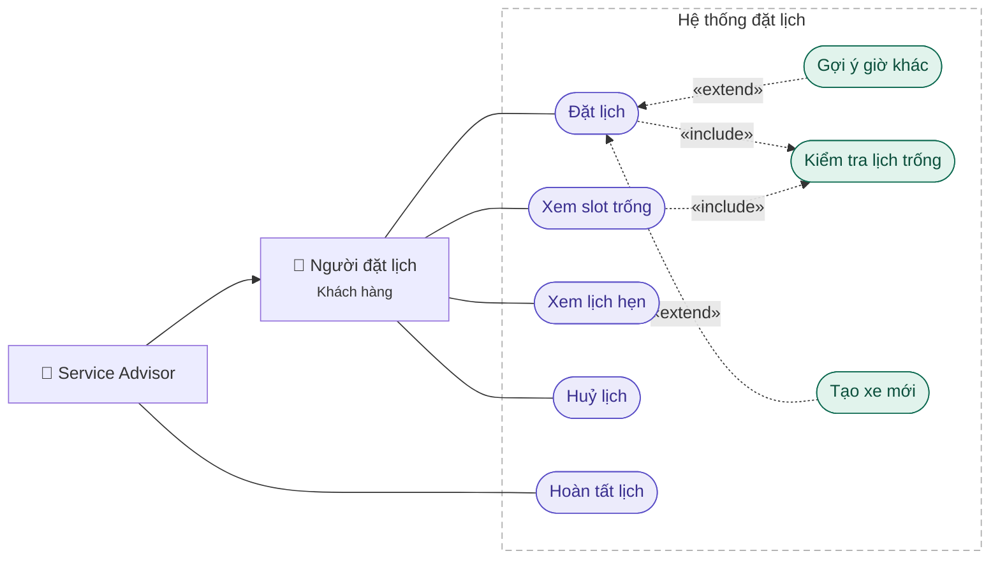
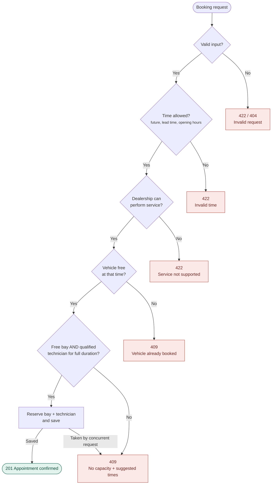
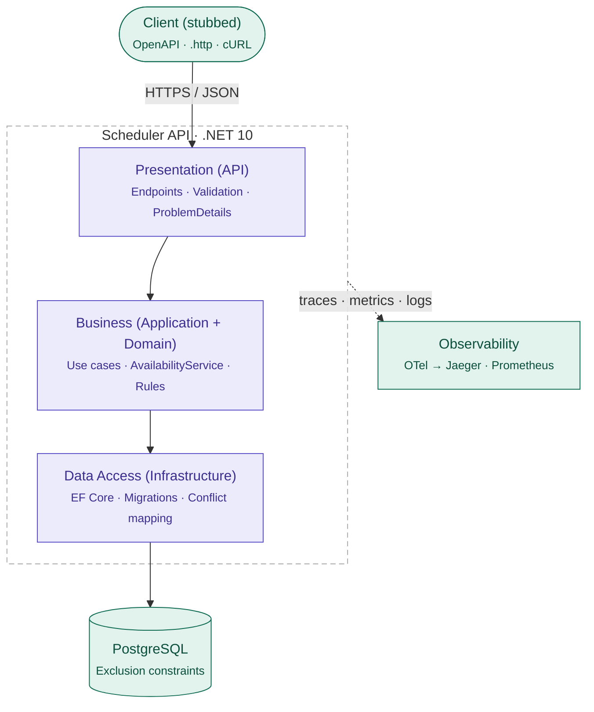
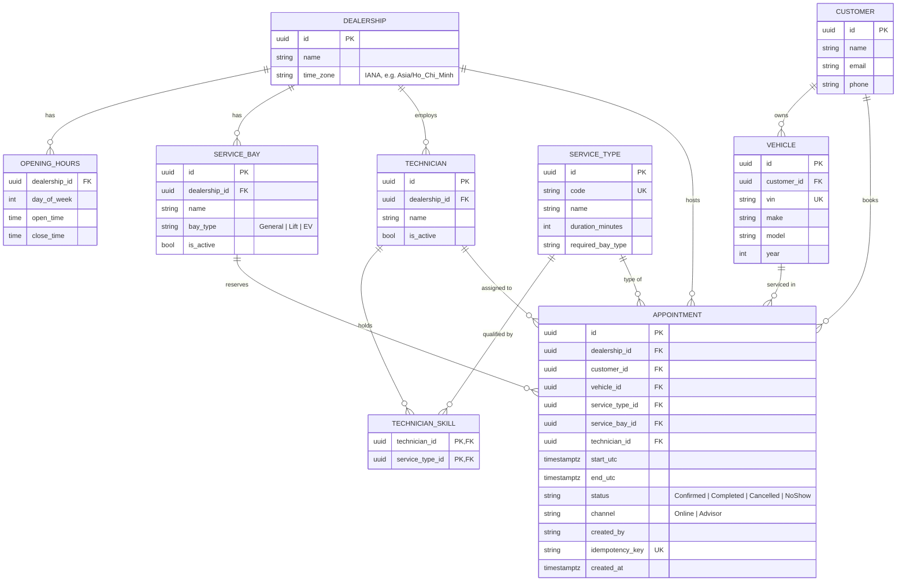
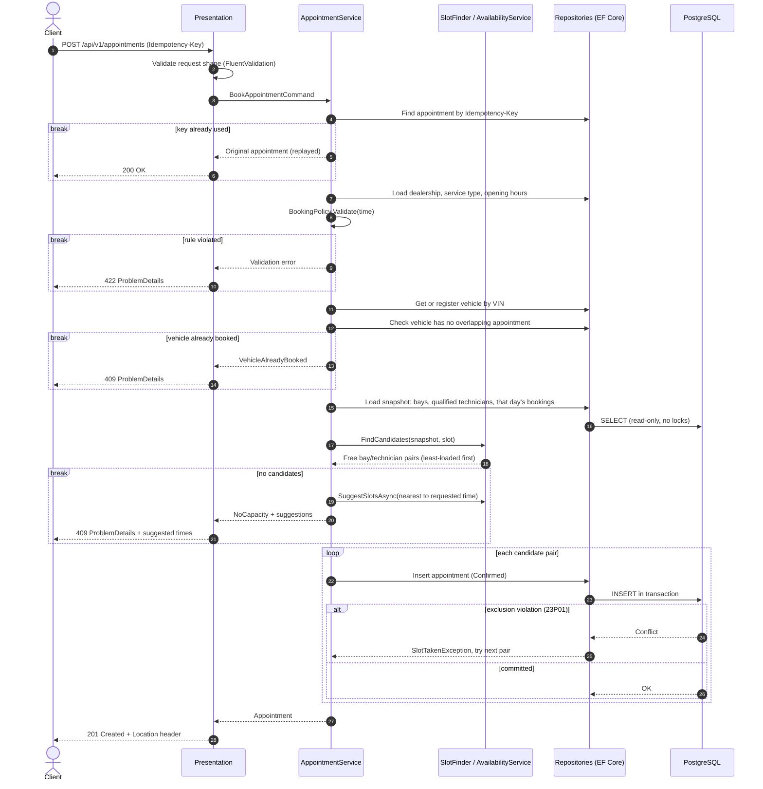

# The unified Service Scheduler

## 1. Overview & scope
- A backend service for booking dealership service appointments. Each booking automatically reserves a suitable service bay and a qualified technician for the full service duration. Built as a .NET 10 modular monolith on PostgreSQL, with double-booking prevented at the database level.

- In scope: book, view available slots, suggest alternative times, view / cancel / complete appointments. OpenAPI spec as the client stub.

- Out of scope: UI, authentication, rescheduling, technician shifts, repair orders & invoicing, notifications. See Future Work.
## 2. Assumptions

| ID | Assumption |
| --- | --- |
| A-01 | The system assigns the bay and technician; users only choose dealership, service type, vehicle and time. |
| A-02 | Each service type has a fixed duration and requires one bay type (e.g. Lift, EV). |
| A-03 | “Qualified technician” = technician holds the skill for that service type. |
| A-04 | Technicians are available during dealership opening hours; individual shifts are not modelled. |
| A-05 | The whole appointment must fit within opening hours. Back-to-back bookings are allowed ([start, end)). |
| A-06 | Start times use 15-minute steps; bookings up to 60 days ahead. Online bookings need 1 hour lead time; advisors can book walk-ins immediately.|
| A-07 | A vehicle (by VIN) cannot have overlapping appointments. Unknown VINs are registered on first booking.|
| A-08 | Only Confirmed appointments hold resources; Cancelled, Completed and NoShow release them. |
| A-09 | Available slots are a snapshot, not a hold; booking may still return 409 Conflict. |
| A-10 | Times are stored in UTC and interpreted in the dealership’s timezone. |

## 3. Use-case Diagram
### 3.1 Diagram



### 3.2 Use-cases
| ID	| Use case | Actor |Summary
|---|---|---|---|
UC-01	| Book Appointment	| Customer, Advisor	| Reserve a bay and qualified technician for a vehicle and service. Advisors may book walk-ins without lead time.
UC-02 | View Available Slots| Customer, Advisor	| List bookable start times for a service on a given day. Read-only.
UC-03 | View Appointment	| Customer, Advisor	| Show appointment details and assigned resources.
UC-04 | Cancel Appointment	| Customer, Advisor	| Cancel a future Confirmed appointment and release its resources.
UC-05 | Complete / Mark No-show	| Advisor	| Close an appointment as Completed or NoShow
## 4. Business process



## 5. Architecture
<div align="center">



</div>

## 6. Domain model


## 7. Data flow


## 8. Concurrency and Consistency

### 8.1 The Problem

Availability is checked and then written in two separate steps. Two requests for the last free slot can both pass the check:

| Time | Request A | Request B |
| --- | --- | --- |
| t1 | Reads: Bay 1 + An free at 09:00 | |
| t2 | | Reads: Bay 1 + An free at 09:00 |
| t3 | Inserts appointment | |
| t4 | | Inserts appointment → **double-booked** |

Application-level checks alone cannot prevent this. Correctness must be guaranteed at the point where data is written.

### 8.2 Options Considered

| Approach | How | Verdict |
| --- | --- | --- |
| Application check only | Check, then insert | Race condition above |
| Pessimistic locking | `SELECT ... FOR UPDATE` on candidate bay/technician rows before inserting | Works, but holds locks while searching; lock ordering must be handled to avoid deadlocks |
| Serializable isolation | Run the booking in a `SERIALIZABLE` transaction | Works, but aborts many unrelated transactions under load; every caller must retry |
| Distributed lock (e.g. Redis) | Lock per resource across instances | Extra infrastructure; still needs a DB-level guarantee if the lock expires |
| Database exclusion constraints | PostgreSQL rejects overlapping intervals for the same resource | **Chosen** |

### 8.3 Chosen Approach: Exclusion Constraints + Optimistic Retry

```sql
CREATE EXTENSION IF NOT EXISTS btree_gist;

ALTER TABLE appointment
  ADD COLUMN slot tstzrange
  GENERATED ALWAYS AS (tstzrange(start_utc, end_utc, '[)')) STORED;

ALTER TABLE appointment ADD CONSTRAINT ex_appointment_bay
  EXCLUDE USING gist (service_bay_id WITH =, slot WITH &&) WHERE (status = 'Confirmed');
ALTER TABLE appointment ADD CONSTRAINT ex_appointment_technician
  EXCLUDE USING gist (technician_id WITH =, slot WITH &&) WHERE (status = 'Confirmed');
ALTER TABLE appointment ADD CONSTRAINT ex_appointment_vehicle
  EXCLUDE USING gist (vehicle_id WITH =, slot WITH &&) WHERE (status = 'Confirmed');
```

- `'[)'` makes intervals half-open, so back-to-back appointments do not conflict (A-05).
- `WHERE status = 'Confirmed'` means cancelled, completed and no-show appointments release resources automatically (A-08).
- EF Core does not model exclusion constraints, so they are created with raw SQL in a migration.

#### Handling a conflict

Each insert runs in its own short transaction. On PostgreSQL error `23P01`, the constraint name decides the outcome:

| Constraint violated | Meaning | Action |
| --- | --- | --- |
| `ex_appointment_bay` / `ex_appointment_technician` | Another request took this pair | Try the next candidate pair |
| `ex_appointment_vehicle` | Vehicle was booked concurrently | Stop, return `409 VEHICLE_ALREADY_BOOKED` |
| All candidates exhausted | Slot genuinely full | Return `409 NO_CAPACITY` with suggestions |

Simplified from `AppointmentService.BookAsync`:

```csharp
foreach (var candidate in candidates.Take(MaxAttempts))
{
    var appointment = Appointment.Confirm(dealership.Id, customer.Id, vehicle.Id, serviceType,
        candidate.ServiceBayId, candidate.TechnicianId, command.Start, command.Channel,
        command.CreatedBy, command.IdempotencyKey, now);
    try
    {
        await appointments.InsertAsync(appointment, ct);
        return new BookingResult(await GetAsync(appointment.Id, ct), Replayed: false);
    }
    catch (SlotTakenException ex) when (ex.Resource is Resource.Bay or Resource.Technician)
    {
        SchedulerTelemetry.BookingRetries.Add(1);   // contention signal; try the next pair
    }
}

var suggestions = await availability.SuggestSlotsAsync(dealership, serviceType, command.Start, command.Channel, ct);
throw new NoCapacityException(limitingResource, suggestions);
```

The repository translates `23P01` into `SlotTakenException` by constraint name, so the service never sees PostgreSQL error codes. After a failed insert it calls `ChangeTracker.Clear()`: otherwise the rejected entity stays tracked as `Added` and the next `SaveChanges` would try to insert it again.

#### Why this approach

- **Correct by construction.** Overlaps are impossible regardless of code paths, bugs, or the number of API instances.
- **No locks held while searching.** The common case (no contention) costs a single insert.
- **Horizontally scalable API.** Instances are stateless; the database is the single arbiter.

### 8.4 Idempotency

`idempotency_key` has a unique index. Clients can safely retry on timeouts:

- **Sequential retry:** the key is found before booking, and the original appointment is returned with `200 OK`.
- **Concurrent retry:** both requests pass the first lookup and race to insert. The loser is rejected either by the unique index (`23505`) or, because it books the same vehicle at the same time, by `ex_appointment_vehicle` (`23P01`). In both cases the service looks the key up again and returns the winner with `200 OK`; only when no appointment has that key is it a real `VEHICLE_ALREADY_BOOKED`.
- **Same key, different booking:** `422 IDEMPOTENCY_KEY_REUSED`. The dealership, service type, start time and vehicle are compared with the stored appointment.
- Registering a new customer (email) or vehicle (VIN) uses the same pattern: a unique violation means a concurrent request registered it first, so the existing row is used.

Verified by a test that sends five parallel requests with one key: exactly one `201`, the rest `200`, and one row.

### 8.5 Read Consistency

Availability queries run at the default `READ COMMITTED` isolation and return a snapshot (A-09). A slot shown as free may be taken before booking; the write path in [8.3](#83-chosen-approach-exclusion-constraints--optimistic-retry) is what guarantees correctness, not the read path.

### 8.6 Verification

An integration test using a real PostgreSQL instance (Testcontainers) sends N parallel booking requests for a slot with exactly one free bay/technician pair and asserts:

- exactly one `201 Created`
- all others `409`
- exactly one `Confirmed` row in the database

A second test with two free pairs asserts both requests succeed on different resources. A third sends parallel retries with one `Idempotency-Key` ([8.4](#84-idempotency)). All three live in `tests/Scheduler.IntegrationTests/ConcurrencyTests.cs` and run in CI.

### 8.7 Trade-off: Database Portability

Exclusion constraints are PostgreSQL-specific. On SQL Server, the equivalent would be serialising bookings per resource with `sp_getapplock`, or using `SERIALIZABLE` with `UPDLOCK, HOLDLOCK` range locks. The business layer is unaffected either way, because only the data access layer translates constraint violations into `SlotTakenException`.

## 9. API Design

### 9.1 Conventions

- Base path `/api/v1`, JSON over HTTPS (TLS is terminated in front of the API, by a reverse proxy or tunnel).
- IDs are UUIDs. Enums (`status`, `channel`, `limitingResource`) are strings.
- Timestamps are ISO 8601 with offset (`2026-11-10T09:00:00+07:00`). Stored as UTC, returned in the dealership's timezone.
- Errors follow RFC 7807 ProblemDetails, extended with a stable machine-readable `code`.
- `POST /appointments` requires an `Idempotency-Key` header ([8.4](#84-idempotency)).
- State changes use explicit action endpoints (`/cancel`, `/complete`, `/no-show`) instead of `PATCH status`. Each maps to one domain transition with its own rules.

### 9.2 Endpoints

| Method | Path | Use case | Success |
| --- | --- | --- | --- |
| GET | `/dealerships` | Reference data | 200 |
| GET | `/service-types` | Reference data | 200 |
| GET | `/dealerships/{id}/availability?serviceTypeId=&date=&channel=` | UC-02 | 200 |
| POST | `/appointments` | UC-01 | 201 (200 when the `Idempotency-Key` is replayed) |
| GET | `/appointments/{id}` | UC-03 | 200 |
| POST | `/appointments/{id}/cancel` | UC-04 | 200 |
| POST | `/appointments/{id}/complete` | UC-05 | 200 |
| POST | `/appointments/{id}/no-show` | UC-05 | 200 |

Operational endpoints (outside `/api/v1`): `/health/live`, `/health/ready` and `/openapi/v1.json`.

### 9.3 Book Appointment

#### Request

```http
POST /api/v1/appointments
Idempotency-Key: 7f3c2a1e-9b8d-4c6f-a2e1-1d5b9c0e4f77
Content-Type: application/json

{
  "dealershipId": "d0000000-0000-0000-0000-000000000001",
  "serviceTypeId": "50000000-0000-0000-0000-000000000002",
  "startTime": "2026-11-10T09:00:00+07:00",
  "channel": "Online",
  "customer": { "name": "Nguyen Van An", "email": "an@example.com", "phone": "+84901234567" },
  "vehicle":  { "vin": "1HGCM82633A004352", "make": "Honda", "model": "Civic", "year": 2021 }
}
```

Customers are matched by email and vehicles by VIN; unknown ones are registered (UC-01 «extend» Register Vehicle).

#### 201 Created

```http
Location: /api/v1/appointments/87135a65-4ac9-4e80-bb06-3a330a343614
traceparent: 00-aeaece4990b0b4348c388002a00ff443-45b62cb058f3d691-01
```

```json
{
  "id": "87135a65-4ac9-4e80-bb06-3a330a343614",
  "status": "Confirmed",
  "channel": "Online",
  "start": "2026-11-10T09:00:00+07:00",
  "end": "2026-11-10T10:30:00+07:00",
  "dealership":  { "id": "d0000000-0000-0000-0000-000000000001", "name": "Keyloop Motors District 1" },
  "serviceType": { "id": "50000000-0000-0000-0000-000000000002", "code": "brake-service", "name": "Brake service", "durationMinutes": 90 },
  "serviceBay":  { "id": "b0000000-0000-0000-0000-000000000001", "name": "Bay 1" },
  "technician":  { "id": "70000000-0000-0000-0000-000000000001", "name": "An" },
  "vehicle":     { "vin": "1HGCM82633A004352" }
}
```

A replayed `Idempotency-Key` returns the same body with `200 OK`.

#### 409 Conflict (no capacity)

```json
{
  "type": "https://api.example.com/problems/no-capacity",
  "title": "No capacity for the requested time",
  "status": 409,
  "code": "NO_CAPACITY",
  "detail": "No technician is free for the requested time.",
  "instance": "/api/v1/appointments",
  "limitingResource": "Technician",
  "suggestedSlots": ["2026-11-10T10:30:00+07:00", "2026-11-10T11:00:00+07:00", "2026-11-10T13:00:00+07:00"],
  "traceId": "00-4bf92f3577b34da6a3ce929d0e0e4736-00f067aa0ba902b7-01"
}
```

`suggestedSlots` are the three free start times nearest to the requested one, searched over the requested day and the six days after it. `traceId` links every error to its trace (see [Observability](#11-observability)).

### 9.4 View Available Slots

```http
GET /api/v1/dealerships/d0000000-0000-0000-0000-000000000001/availability?serviceTypeId=50000000-0000-0000-0000-000000000002&date=2026-11-10
```

```json
{
  "date": "2026-11-10",
  "serviceTypeId": "50000000-0000-0000-0000-000000000002",
  "durationMinutes": 90,
  "slots": [
    { "start": "2026-11-10T08:00:00+07:00", "end": "2026-11-10T09:30:00+07:00" },
    { "start": "2026-11-10T10:30:00+07:00", "end": "2026-11-10T12:00:00+07:00" }
  ]
}
```

A closed day returns an empty `slots` array with `"reason": "CLOSED"`. `channel` defaults to `Online`, which hides starts inside the one-hour lead time; `channel=Advisor` shows them (A-06).

### 9.5 Error Codes

| Status | Code | When |
| --- | --- | --- |
| 400 | `MALFORMED_REQUEST` | Invalid JSON or missing `Idempotency-Key` |
| 404 | `NOT_FOUND` | Unknown dealership, service type or appointment |
| 409 | `NO_CAPACITY` | No free bay/technician pair; includes `suggestedSlots` |
| 409 | `VEHICLE_ALREADY_BOOKED` | Vehicle has an overlapping appointment |
| 409 | `INVALID_STATUS_TRANSITION` | e.g. cancelling a completed appointment |
| 422 | `VALIDATION_FAILED` | Field-level errors (VIN format, email, etc.) |
| 422 | `INVALID_TIME` | Past, insufficient lead time, not on 15-min step, beyond 60 days |
| 422 | `OUTSIDE_OPENING_HOURS` | Appointment does not fit opening hours or day is closed |
| 422 | `SERVICE_NOT_SUPPORTED` | Dealership has no bay or technician able to perform the service |
| 422 | `VIN_OWNED_BY_OTHER_CUSTOMER` | VIN registered to a different customer |
| 422 | `IDEMPOTENCY_KEY_REUSED` | Same key sent with a different payload |

### 9.6 Client Stub

The OpenAPI document is generated from code and served at `/openapi/v1.json`; any OpenAPI generator (NSwag, Kiota, openapi-generator) can produce a typed client from it. The repository also includes `requests/appointments.http` with ready-to-run examples for every endpoint and most error cases, usable from Rider, Visual Studio or VS Code (REST Client).

## 10. Technology Choices

| Area | Choice | Why | Alternatives considered |
| --- | --- | --- | --- |
| Runtime | C# / .NET 10 (LTS) | Supported until Nov 2028; strong typing and async I/O; my primary stack | .NET 8 (end of support Nov 2026), Java / Spring Boot |
| Web framework | ASP.NET Core Web API (controllers) | Clear structure for multiple resources, built-in model binding, ProblemDetails and OpenAPI support | Minimal APIs (equally valid, less structure as endpoints grow) |
| Database | PostgreSQL | `tstzrange` + exclusion constraints guarantee no double-booking at the DB level ([section 8](#8-concurrency-and-consistency)); open source; runs anywhere via Docker | SQL Server (no exclusion constraints, would need application locks); MongoDB (no cross-document constraint guarantees for this use case) |
| Data access | EF Core + Npgsql | Migrations, LINQ projections, change tracking; raw SQL where needed for constraints | Dapper (faster, but more boilerplate for writes and migrations) |
| Validation | FluentValidation | Validation rules kept separate from DTOs and unit-testable | DataAnnotations (harder to express cross-field rules) |
| Time | `TimeProvider` (built-in) | Business rules depend on "now" (lead time, past dates); a fake clock makes them deterministic in tests | Custom `IClock` interface |
| Logging | Serilog (JSON to stdout) | Structured logs with enrichment (correlation ID, trace ID); stdout fits containers | Built-in `ILogger` only |
| Tracing & metrics | OpenTelemetry → Jaeger, Prometheus | Vendor-neutral standard; stable instrumentation for ASP.NET Core and Npgsql (every SQL command is a span) | Vendor APM agents (lock-in) |
| API contract | Built-in OpenAPI + `.http` files | Contract generated from code stays in sync; `.http` files act as the client stub | Postman collection |
| Testing | xUnit + Testcontainers | Integration tests run against a real PostgreSQL, the only way to verify exclusion constraints and concurrency | EF Core InMemory provider (cannot enforce constraints, would give false confidence) |
| Local run | Docker Compose | One command starts API, PostgreSQL, Jaeger and Prometheus | Manual setup |
| CI | GitHub Actions | Build and test on every push, next to the repository | Azure DevOps Pipelines |

## 11. Observability

Built on OpenTelemetry so that logs, metrics and traces share the same `traceId`. Any failed request can be followed from the error response to its log lines and its full trace.

### 11.1 Logging

Serilog writes structured JSON to stdout.

| Aspect | Approach |
| --- | --- |
| Standard fields | trace ID (`@tr`), span ID (`@sp`), `RequestId`, `RequestPath`; `DealershipId`, `AppointmentId` when known |
| Business events | `Information`: `AppointmentBooked`, `BookingRejected {Code}`, `AppointmentCancelled` / `Completed` / `NoShow` |
| Contention | `Information` per retry; `Warning` when all candidates are exhausted under contention |
| Failures | `Error` for unhandled exceptions, with stack trace |
| Privacy | No customer name, email or phone in logs; VIN masked to last 6 characters |

### 11.2 Metrics

Custom meter `Scheduler`, pushed over OTLP to Prometheus' OTLP receiver (no `/metrics` endpoint to expose or secure). Everything uses `System.Diagnostics.Metrics` and `ActivitySource`, which are built into .NET, so the Application layer has no OpenTelemetry dependency:

| Metric | Type | Tags | Answers |
| --- | --- | --- | --- |
| `scheduler.bookings` | Counter | `result` (`created`, `replayed`, `no_capacity`, `vehicle_booked`, `invalid`), `channel`, `dealership` | Booking success rate; which dealerships run out of capacity |
| `scheduler.booking.retries` | Counter | `dealership` | How often concurrent requests collide ([section 8](#8-concurrency-and-consistency)) |
| `scheduler.booking.duration` | Histogram | `result` | End-to-end booking latency |
| `scheduler.availability.duration` | Histogram | — | Cost of slot calculation |
| `scheduler.appointment.transitions` | Counter | `to` (`Cancelled`, `Completed`, `NoShow`) | Cancellation and no-show rates |

Built-in instrumentation adds HTTP request duration, database call duration and .NET runtime metrics (GC, thread pool). Tags are kept low-cardinality: `dealership` is a bounded set, IDs are never used as tags.

Some metrics double as business signals: a rising `no_capacity` rate for a dealership indicates it needs more bays or technicians; the no-show rate supports reminder policies.

### 11.3 Tracing

| Span | Source | Key attributes |
| --- | --- | --- |
| HTTP request | ASP.NET Core auto-instrumentation | route, status code |
| SQL commands | Npgsql instrumentation | statement, duration |
| `Booking.Validate` | Custom | wraps the `BookingPolicy` rule checks |
| `Availability.FindCandidates` | Custom | candidate count |
| `Booking.Insert` | Custom, one per attempt | attempt number, outcome (`committed` / `slot_taken`) |

The `traceId` is returned in every error response ([section 9.3](#93-book-appointment)) and in the `traceparent` header, so support can jump directly from a customer complaint to the trace. Sampling is 100% locally; in production, a ratio-based sampler with all error traces retained.

### 11.4 Health Checks

- `/health/live`: process is running (no checks, so a database outage does not get the process restarted).
- `/health/ready`: database is reachable (EF Core `DbContext` check). Used by the orchestrator to stop routing traffic during outages.

### 11.5 Alerts (examples)

| Condition | Why |
| --- | --- |
| 5xx rate > 1% for 5 min | Unexpected failures |
| p95 `booking.duration` > 500 ms | Degraded user experience |
| `booking.retries` sharply above baseline | Abnormal contention or a client retry storm |
| `/health/ready` failing | Database unavailable |

### 11.6 Local Setup

`docker compose up -d` starts PostgreSQL, Jaeger (traces at `localhost:16686`) and Prometheus (metrics at `localhost:9090`); the API run with `dotnet run` exports to them (endpoints in `appsettings.Development.json`). Adding `-f docker-compose.prod.yml` also runs the API in a container, wired to the same services. Exporters are only enabled when an endpoint is configured, so tests run without them. Dashboards in Grafana are future work.

## 12. Scalability & Future Work

### 12.1 Scaling Path

| Pressure | Approach |
| --- | --- |
| More API traffic | The API is stateless; run multiple instances behind a load balancer. Correctness does not depend on instance count, because the database arbitrates conflicts ([section 8](#8-concurrency-and-consistency)). |
| Read-heavy availability queries | Cache reference data (dealerships, service types, opening hours) in memory with a short TTL. Route availability reads to a read replica; slight staleness is acceptable since results are already a snapshot (A-09). |
| Large `appointment` table | Partition `appointment` by `dealership_id`. PostgreSQL only allows unique and exclusion constraints on a partitioned table when they include the partition key, so the bay and technician constraints become `EXCLUDE (dealership_id WITH =, service_bay_id WITH =, slot WITH &&)`. That is equivalent, because bays and technicians belong to one dealership. The idempotency index becomes `(dealership_id, idempotency_key)`. Trade-off: the vehicle constraint (A-07) spans dealerships, so it can no longer be one constraint; it would move to an application check guarded by a per-vehicle advisory lock. |
| Multi-tenancy (dealer groups) | Add `tenant_id` to all tables with PostgreSQL row-level security, so tenants cannot read each other's data even if a query forgets a filter. |
| Database availability | Managed PostgreSQL with automatic failover; idempotency keys make client retries safe across failovers. |

### 12.2 Future Work

| Item | Notes |
| --- | --- |
| Authentication & roles | OAuth2 / OIDC; Customer sees own appointments, Advisor manages a dealership |
| Atomic reschedule | Cancel and rebook in one transaction, so the customer never loses their original slot if the new one is taken |
| Technician shifts, leave, public holidays | Availability currently assumes technicians work full opening hours |
| Notifications | Transactional outbox → RabbitMQ (MassTransit) → notification service for confirmations and reminders; reminders also reduce no-shows |
| Advisor daily board | `GET /appointments?dealershipId=&date=` with pagination |
| Smarter assignment | Balance workload across the day, prefer specialists, configurable buffer between jobs |
| Rate limiting | Protect booking and availability endpoints from abuse |
| Dashboards | Grafana over the metrics in [section 11](#11-observability) |
| Repair orders & invoicing | Hand a completed appointment to the dealer management system |
| Concurrent status changes | Two simultaneous transitions on one appointment (e.g. cancel and complete) are last-writer-wins today; add PostgreSQL's `xmin` as an EF Core concurrency token and return `409` on conflict |
| Configurable rules per dealership | `BookingRules` (step, lead time, horizon) is global configuration today |

## 13. GenAI-Assisted Design

### 13.1 Approach

I used Claude as a design partner throughout this phase. My working rule was: **AI drafts, I decide.** The AI produced options, drafts and diagrams quickly. I set the method, challenged its assumptions, and made every scope and design decision.

### 13.2 Directing the Process

The AI's first instinct was to jump straight to a technical solution (stack, database constraints, endpoints). I stopped that and imposed the analysis order I trust:

**business process → use cases and cases → three-layer architecture → sequence diagrams**

Requirements and test cases the AI had already drafted were treated as provisional and re-derived from the business process diagram, so every branch in the flow maps to at least one case.

### 13.3 Where I Changed the AI's Output

| AI output | My intervention | Result |
| --- | --- | --- |
| Initial scope treated "Service Advisor" only as a second booker | Asked what a service advisor actually does for a customer | Added walk-in bookings without lead time, a `NoShow` status, and booking channel for auditing |
| First Overview and Assumptions: about 20 assumptions explaining dealership basics | Reviewers are domain experts; only behaviour-changing decisions belong there | Cut to 10 assumptions using the rule "include it only if changing it would change the code" |
| Data flow assumed to mean a sequence diagram | Questioned the choice; compared DFD, flowchart and sequence diagram | Kept a sequence diagram for the booking flow ([section 7](#7-data-flow)): the order of calls across layers matters most there, and a DFD cannot show it |
| Separate `NO_BAY_AVAILABLE` / `NO_TECHNICIAN_AVAILABLE` errors | Simplified client handling | Single `NO_CAPACITY` code with a `limitingResource` field |
| Proposed .NET 8 | Checked against the current support lifecycle | Switched to .NET 10 LTS (.NET 8 support ends November 2026) |

### 13.4 How I Verified the Design

- **Executable prototype before code.** I had the AI build a small interactive scheduler implementing the business rules, then ran each case (partial overlaps, back-to-back slots, closing time, technician busy while bay is free, cancellation releasing resources) to confirm the rules behaved as intended.
- **Understanding before accepting.** I did not accept the exclusion-constraint design until I could see it work. I asked for a step-by-step simulation of two concurrent requests, comparing no constraint, one remaining pair and two remaining pairs, which made the race condition and its resolution concrete.
- **Traceability.** Business process branches → use case flows → numbered test cases, so gaps show up as a branch with no case.
- **Checklist against the brief.** Every required section of the System Design Document was mapped to a heading before writing.

### 13.5 Lessons

- AI defaults to solution-first and verbose output; results improved when I fixed the process and the audience.
- Asking "why" and "what does this role actually do" surfaced requirements that neither the brief nor the first draft contained.
- Facts that change over time (framework support dates) must be checked, not trusted from the AI's first answer.
